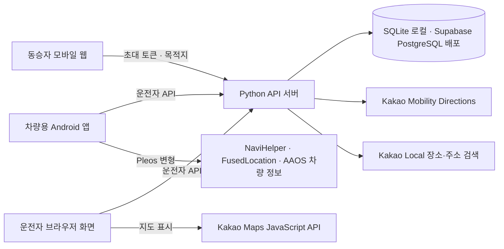

# MOAGIL | 모아길

**여러 사람의 목적지를 모아, 차량의 실제 도로망을 기준으로 하차 순서를 추천하는 공동 이동 프로토타입입니다.**

동승자는 QR로 참여해 이름과 목적지를 등록합니다. 운전자는 차량 화면에서 참가 현황과 추천 순서를 확인하고, 다음 하차 목적지를 Pleos 내비게이션으로 전달할 수 있습니다.

**공모전 제출물:** [시연 영상](https://youtu.be/u-7vw_0MuKI) · [서명된 Pleos ARM64 APK](apk/MOAGIL_Moagil_release.apk) · [GitHub 저장소](https://github.com/kimps005/MOAGIL)

바로 체험하려면 [서비스 소개](https://moagil-eta.vercel.app/) 또는 [운전자 화면](https://moagil-eta.vercel.app/app)을 여세요. 배포된 서버에 연결하는 경우 별도의 Kakao 키 입력이나 로컬 서버 실행은 필요하지 않습니다.

## 공모전 제출 정보

| 제출 항목 | 제출 내용 |
|---|---|
| 접수양식·기획서 (필수) | [공식 접수양식 및 개인정보 수집·이용 동의서 DOCX](https://appdevchallenge.auto-hmg.io/downloads/contest-application-consent.docx)을 내려받아 작성합니다. |
| 시연 영상 (선택) | [MOAGIL 시연 영상 YouTube 링크](https://youtu.be/u-7vw_0MuKI) |
| GitHub 저장소 (선택) | [kimps005/MOAGIL](https://github.com/kimps005/MOAGIL) · 소스 코드 포함 |
| 실행 APK (선택) | [MOAGIL_Moagil_release.apk](apk/MOAGIL_Moagil_release.apk) · Pleos/AAOS ARM64용 · [파일 정보와 SHA-256](apk/README.md) |
| 숏폼 링크 (선택) | 본상 가산점은 없으며 별도 특별상으로 운영됩니다. 참여 우수작 1팀에 상금 50만 원과 현대자동차그룹 공식 행사 초청이 안내되어 있습니다. |

시연 영상·GitHub 저장소·APK는 선택 제출이며, 1차 접수 때 제출하면 산출물 수준에 따라 가산점이 부여됩니다. 2차 PT 대상 팀은 PT 전까지 실제 동작 가능한 앱을 완성해야 합니다.

접수 기간은 **2026-10-21부터 2026-11-15까지**입니다. 개인 또는 팀으로 참가할 수 있고 팀은 대표자를 포함해 최대 5명입니다. 접수 메일은 `appdevchallenge@hyundai-partners.com`이며 제목은 `[차량용 앱 개발 공모전] 팀명(개인은 성명)_대표자명` 형식입니다. 참가자 전원이 각자 동의 여부·서명·날짜를 작성하고, 대표자는 팀원 전원을 참조(CC)에 포함해야 합니다. 작성된 개인정보 동의서는 공개 저장소 대신 접수 이메일에 첨부하세요.

수정 제출은 최초 제출에 사용한 이메일 주소에서 제목 앞에 `[수정제출]`을 붙여 보냅니다. 전체 제출물과 모든 참가자의 서명 동의서를 다시 첨부하고 팀원 전원을 CC에 포함합니다. 제출 요건과 확인 내역은 [공모전 제출 점검](docs/submission.md)에 정리했습니다.

## 서비스 흐름

1. 차량 화면에서 이동 세션과 초대 QR을 엽니다.
2. 동승자가 QR을 스캔하고 지도에서 목적지를 검색·조정해 등록합니다.
3. 새 목적지는 세션에 반영되며 서버가 하차 순서를 다시 계산합니다.
4. 동승자는 전용 화면에서 자신의 하차 순서와 예상 시간을 확인하고, 운행 시작 전까지 목적지를 수정할 수 있습니다.
5. 운전자는 추천 순서를 확인하거나 직접 조정하고, Pleos 앱은 그 순서의 다음 목적지 하나를 차량 내비게이션에 요청합니다.

## 주요 기능

| 영역 | 기능 |
|---|---|
| 동승자 참여 | 세션별 QR, 이름 입력, 장소 검색, 지도 핀 조정, 최대 4명, 전용 진행 화면의 하차 순서·예상 시간, 출발 전 목적지 수정 |
| 차량 화면 | 세션 동기화, 추천 순서 및 수동 조정, Kakao 지도 표시. 실제 길안내는 Pleos 내비를 사용 |
| 경로 추천 | 실제 도로망 비용을 기준으로 가능한 하차 순서를 비교하고 선택 경로를 표시 |
| Pleos 연동 | 선택한 하차 순서의 다음 목적지를 하나씩 NaviHelper에 전달 |
| 차량 상태 | Pleos FusedLocation과 AAOS 차량 속도·기어 정보를 읽어 출발지와 운전자 조작 조건에 반영 |
| 웹 지도 | Kakao Maps 표시와 Kakao Local 검색 |

경로 추천은 생성형 AI 호출이 아니라 **가능한 순서를 모두 비교하는 최적화 계산**입니다. 목적지 4개는 최대 24개 순서, 첫 하차를 고정하면 6개 순서를 평가합니다.

## 시스템 구성



| 구성 요소 | 기술 |
|---|---|
| 서버·API | Python 3.12, 로컬 SQLite 또는 배포용 Supabase PostgreSQL |
| 참가·운전자 웹 | HTML, CSS, JavaScript, Kakao Maps JavaScript API |
| 차량 앱 | Kotlin, Jetpack Compose, Android Automotive OS |
| 기본 경로 제공자 | Kakao Mobility 실시간 길찾기 (REST 키 필요) |
| 지도·검색 데이터 | Kakao Maps 및 Kakao Local |
| 선택 연동 | Pleos Connect SDK |

## 빠른 시작

### 요구 환경

- Windows PowerShell
- Python 3.12 이상
- 지도·장소 검색·경로 기능을 사용할 인터넷 연결

### 서버와 웹 실행

저장소 루트에서 실행합니다.

```powershell
.\Start-MOAGIL.ps1
```

서비스 소개 페이지는 [http://localhost:8080](http://localhost:8080), 운전자 화면은 [http://localhost:8080/app](http://localhost:8080/app)에서 엽니다. 배포도 `https://moagil-eta.vercel.app/`은 소개 페이지이고, 실제 운전자 화면은 `/app`, 참가 QR 화면은 세션별 `/join/<세션 ID>` 주소를 사용합니다. 기본 서버는 참가자의 휴대폰이 같은 네트워크에서 접속할 수 있도록 모든 네트워크 인터페이스에서 대기합니다.

휴대폰이 다른 네트워크에 있으면 서버를 외부 HTTPS 주소나 임시 터널에 연결해야 합니다. 서버를 시작하기 전에 QR에 넣을 주소를 설정합니다.

```powershell
$env:MOAGIL_PUBLIC_BASE_URL = 'https://공개-접속-주소'
.\Start-MOAGIL.ps1
```

터널 생성과 서버 공개는 별도로 준비해야 합니다. Android 앱은 Kakao Maps 도메인을 고정하기 위해 기본적으로 배포 주소 `https://moagil-eta.vercel.app`에 연결합니다. 로컬 서버를 테스트할 때는 앱의 서버 주소 설정을 `http://10.0.2.2:8080`으로 바꿀 수 있지만, 이 로컬 주소를 Kakao Developers 허용 도메인에도 등록해야 지도가 표시됩니다.

### Vercel 고정 주소와 Supabase 데이터베이스

Vercel은 프로젝트마다 고정된 `프로젝트이름.vercel.app` 주소를 제공합니다. 배포별 미리보기 주소는 바뀔 수 있으므로 Kakao Developers에는 미리보기 주소가 아니라 이 프로젝트 주소만 등록합니다. Vercel은 정적 웹 화면과 Python HTTP 함수를 함께 배포하며, 이 저장소의 API 경로는 `vercel.json`이 기존 화면의 `/api/...` 경로로 연결합니다.

로컬에서는 기존 SQLite를 계속 사용할 수 있습니다. Vercel에서는 함수의 로컬 파일을 세션 저장소로 쓰지 않고 Supabase PostgreSQL에 세션과 동승자 데이터를 저장합니다. 서버가 처음 요청을 받을 때 필요한 테이블을 생성하므로 Supabase SQL 편집기에 별도 스키마를 붙여넣을 필요가 없습니다.

Vercel 프로젝트의 서버 환경 변수에 다음 항목을 설정합니다.

| 변수 | 값 |
|---|---|
| `MOAGIL_DATABASE_URL` | Supabase PostgreSQL 연결 문자열. Vercel 같은 서버리스 배포에서는 Supabase Transaction Pooler 연결 문자열을 사용하고 SSL을 켭니다. |
| `MOAGIL_KAKAO_REST_API_KEY` | Kakao Local 장소 검색과 Kakao Mobility 길찾기에 쓰는 서버 전용 REST 키 |
| `MOAGIL_KAKAO_JAVASCRIPT_KEY` | Kakao 지도를 표시하는 JavaScript 키 |
| `MOAGIL_PUBLIC_BASE_URL` | `https://프로젝트이름.vercel.app` 형식의 고정 프로젝트 주소 |

이 값들은 브라우저 코드나 GitHub 저장소에 넣지 말고 Vercel의 서버 환경 변수로 저장합니다. 배포 후 Kakao Developers의 JavaScript SDK 도메인에는 `https://프로젝트이름.vercel.app`을 등록합니다. 동승자 초대는 이미 세션별 고유 ID와 초대 토큰을 사용하는 `/join/<세션 ID>` 경로를 사용합니다.

현재 공개 배포 주소는 `https://moagil-eta.vercel.app`입니다. 2026-11-07에 공개 API와 데이터베이스 상태, 실제 세션·경로 흐름을 확인했습니다. 별도 배포를 만들려면 Vercel 프로젝트에 이 GitHub 저장소를 연결하고, 위 환경 변수에 본인 Kakao 키와 Supabase 연결 문자열을 저장합니다.

## 경로 계산

Kakao REST 키로 Kakao Mobility 길찾기의 실시간 교통 시간·거리 행렬을 받아 가능한 하차 순서를 평가하고, 비교 결과와 선택 경로를 세션 저장소에 저장합니다. 로컬 실행은 SQLite, Vercel 배포는 Supabase PostgreSQL을 사용합니다. Kakao 키가 없거나 Kakao 요청이 실패하면 다른 지도/경로 제공자로 바꾸지 않고 오류를 표시합니다. 예상 시간이 같으면 도로 거리가 짧은 순서를 우선합니다. Pleos 앱은 선택된 하차 순서대로 다음 목적지 하나만 Pleos NaviHelper에 요청합니다. 하차 확인 후 현재 위치에서 다음 목적지를 새로 요청하고, 최종 목적지는 승객 하차 후 별도로 요청합니다. 한 명을 첫 번째로 고정하면 나머지 순서만 평가합니다.

Pleos 화면에는 Kakao 지도가 표시됩니다. 기본 차량 내비게이션은 Pleos 시스템이 관리하므로 동승자 창의 앱 라이브러리에서 모아길을 실행하고, 자주 쓰는 경우 동승자 GNB 즐겨찾기에 추가합니다. 창 배치는 Pleos 시스템이 관리합니다.

- Kakao 길찾기는 현재 교통 정보를 반영하지만 API 사용 한도와 초과 요금이 적용될 수 있습니다. 무료·무제한 제공은 아닙니다.
- **AI 최적 경로**를 누르면 Kakao 다중 출발지 API에서 현재 시간표를 받아 가능한 순서를 비교합니다. 선택한 시간표·순서·경로선은 서버의 세션 DB에 저장됩니다.
- 지도 표시는 Kakao Maps만 사용합니다. Kakao JS 키 또는 네트워크 연결이 없으면 대체 지도를 표시하지 않고 원인을 안내합니다.
- 지도 표시와 도로 경로 계산은 Kakao만 사용합니다. Kakao JavaScript 키의 Web 플랫폼 허용 도메인에 PC 웹 주소와 QR 참가 주소를 등록해야 합니다.
- 장소 검색은 `MOAGIL_KAKAO_REST_API_KEY`가 있으면 Kakao Local 키워드·주소 API를 사용하고, 키가 없으면 Photon 공개 API를 사용합니다. Kakao Local은 지번·도로명 주소를 지원하지만 API 키와 사용량 한도가 있습니다. Photon은 공개 서비스라 이용량 제한이나 가용성을 보장하지 않습니다.

## 설정

서버 설정은 저장소 루트의 `.env` 파일 또는 프로세스 환경 변수로 지정합니다. [.env.example](.env.example)을 참고하세요.

| 변수 | 용도 |
|---|---|
| `MOAGIL_PUBLIC_BASE_URL` | QR에서 참가자가 열 서버 주소 |
| `MOAGIL_KAKAO_REST_API_KEY` | Kakao Local 장소 검색 및 Kakao Mobility 실시간 길찾기에 사용하는 REST API 키 |
| `MOAGIL_KAKAO_JAVASCRIPT_KEY` | 웹에서 Kakao 지도를 표시하는 JavaScript 키 |
| `MOAGIL_DB` | SQLite 데이터베이스 파일 위치 변경 |
| `MOAGIL_DATABASE_URL` | 배포에서 사용하는 Supabase PostgreSQL 연결 문자열 |

Kakao Local 검색과 Kakao Mobility 길찾기를 사용하려면 REST API 키를 루트 `.env`의 `MOAGIL_KAKAO_REST_API_KEY`에 넣고 서버를 재시작합니다. JavaScript 키의 Kakao Developers Web 플랫폼 허용 도메인에는 실제 PC 접속 주소와 QR 참가 주소를 등록합니다. Kakao Mobility Directions API 이용 한도와 요금을 확인하세요. REST 키는 브라우저로 보내지 않고 서버에서만 사용합니다.

Kakao Maps를 표시하려면 JavaScript 키를 `MOAGIL_KAKAO_JAVASCRIPT_KEY`에 설정합니다. 배포 앱은 고정 주소 `https://moagil-eta.vercel.app`에서 지도 SDK를 요청하므로 이 origin을 Kakao Developers의 JavaScript SDK 도메인에 등록합니다. 세션별 `/join/<세션 ID>`는 같은 origin 아래 경로라 각각 등록할 필요가 없습니다. 로컬에서 지도까지 시험할 때만 `http://localhost:8080`, `http://127.0.0.1:8080`, Android Emulator의 `http://10.0.2.2:8080`을 추가합니다.

## Android 및 Pleos

| 빌드 변형 | 패키지 | 용도 |
|---|---|---|
| `mockDebug` | `kr.moagil.vehicle.mock` | 시연용 정차 스위치와 모의 내비게이션 |
| `pleosDebug` | `kr.moagil.vehicle` | Pleos NaviHelper, 차량 위치·속도·기어 연동 |

### 빌드

JDK 17, Android SDK API 34, Build Tools 36.0.0 및 Pleos SDK 저장소 접근이 필요합니다.

```powershell
cd vehicle-app
.\gradlew.bat testMockDebugUnitTest assembleMockDebug assemblePleosDebug
```

Pleos 변형은 `FUSED_LOCATION`, `CAR_SPEED`, `CAR_POWERTRAIN` 및 NaviHelper 권한을 사용합니다. Playground에서 해당 권한 범위가 승인되어야 합니다. 권한이나 차량 신호를 읽지 못하면 앱은 운전자 조작을 잠급니다.

Mock과 Pleos 빌드는 서로 다른 패키지로 설치됩니다. 두 변형을 함께 설치하면 앱 아이콘이 두 개 표시됩니다. Pleos 에뮬레이터 시험에는 Pleos 변형만 설치하세요.

### 제출 APK 설치·실행

제출 APK는 Android API 28 이상이 설치된 Pleos/AAOS ARM64 차량 환경용입니다. 일반 스마트폰 앱이 아니며 Pleos NaviHelper와 차량 권한이 필요합니다. 기기를 USB/ADB로 연결한 뒤 저장소 루트에서 설치합니다.

```powershell
adb install apk/MOAGIL_Moagil_release.apk
```

설치 후 Pleos 앱 목록에서 **모아길 Pleos**를 실행합니다. APK는 기본 배포 서버 `https://moagil-eta.vercel.app`에 연결합니다.

**검증 상태:** 2026-11-07에 공개 웹 서비스의 Kakao 지도 타일 표시와 실제 Kakao Mobility 경로·참가·하차 흐름을 확인했습니다. 서명된 Pleos release APK를 빌드하고 APK 서명·설정을 확인했으며, 동일 인증서의 x86_64 변형은 격리 Pleos 에뮬레이터에서 설치·실행했습니다. 실차 ARM64 설치, 차량 위치·속도·기어 신호 수신 및 실주행은 확인하지 않았습니다. APK 제출 상태와 남은 조건은 [제출 점검](docs/submission.md), 상세 이력은 [검증 문서](docs/validation.md)를 참고하세요.

## 테스트 및 검증

```powershell
# 저장소 루트에서 브라우저 테스트 의존성 설치
corepack pnpm install --frozen-lockfile

# 서버와 세션 규칙
python -m unittest discover -s backend/tests -v

# 브라우저 UI 및 전체 흐름
npm run test:ui
npm run test:e2e
```

브라우저 검증에는 Node.js 의존성이 필요합니다. 저장소의 `pnpm-lock.yaml`을 사용해 설치한 뒤 테스트를 실행하세요. E2E 검증은 별도 안내가 없는 한 실행 중인 로컬 서버를 대상으로 합니다. Android 빌드·Pleos 에뮬레이터 기록과 미검증 항목은 [docs/validation.md](docs/validation.md)에 정리되어 있습니다.

## 알려진 제한

- Kakao Mobility 길찾기는 실시간 교통 정보를 제공하며, API 이용 한도와 초과 요금이 적용될 수 있습니다.
- Kakao Maps JavaScript 키의 허용 도메인에 현재 실행 origin과 QR 참가 origin을 등록해야 실제 지도를 표시할 수 있습니다.
- Pleos 내비게이션에서 `onRoutingCompleted`는 테스트 중 수신되지 않았습니다. 선택 목적지와 일치하는 `onDrivingInfo` 수신으로 목적지 전달을 확인했습니다.
- Pleos 차량 센서 신호는 에뮬레이터에서 확인되지 않았습니다. 실차 주행에 사용하지 마세요.
- 기본 실행 설정은 개발·시연용입니다. 인터넷 운영 전에는 HTTPS 종단, 외부 공개 범위, 데이터 보존·삭제 정책, 운영 모니터링을 별도로 설계해야 합니다.

## 문서

- [공모전 제출 점검과 남은 작업](docs/submission.md)
- [PRD](docs/PRD.md)
- [아키텍처와 설계 결정](docs/architecture.md)
- [검증 기록](docs/validation.md)
- [Android 앱 및 빌드 안내](vehicle-app/README.md)
- [APK 정보와 체크섬](apk/README.md)
- [시연 스토리보드](docs/DEMO.md)
