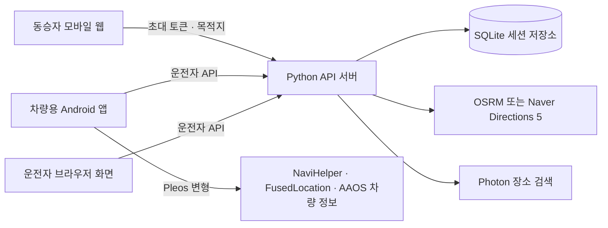

# MOAGIL | 모아길

**여러 사람의 목적지를 모아, 차량의 실제 도로망을 기준으로 하차 순서를 추천하는 공동 이동 프로토타입입니다.**

동승자는 QR로 참여해 이름과 목적지를 등록합니다. 운전자는 차량 화면에서 참가 현황과 추천 순서를 확인하고, 다음 하차 목적지를 Pleos 내비게이션으로 전달할 수 있습니다.

## 서비스 흐름

1. 차량 화면에서 이동 세션과 초대 QR을 엽니다.
2. 동승자가 QR을 스캔하고 지도에서 목적지를 검색·조정해 등록합니다.
3. 새 목적지는 세션에 반영되며 서버가 하차 순서를 다시 계산합니다.
4. 운전자는 추천 순서를 확인하거나 직접 조정하고, Pleos 앱에서는 선택된 다음 목적지를 차량 내비게이션으로 보냅니다.

## 주요 기능

| 영역 | 기능 |
|---|---|
| 동승자 참여 | 세션별 QR, 이름·이모지, 장소 검색, 지도 핀 조정, 최대 4명 |
| 차량 화면 | 세션 동기화, 지도상의 출발지·목적지 표시, 추천 순서 및 수동 조정 |
| 경로 추천 | 실제 도로망 비용을 기준으로 가능한 하차 순서를 비교하고 선택 경로를 표시 |
| Pleos 연동 | NaviHelper를 통한 다음 하차 목적지 전달 |
| 차량 상태 | Pleos FusedLocation과 AAOS 차량 속도·기어 정보를 읽어 출발지와 운전자 조작 조건에 반영 |
| 대체 지도 | OpenStreetMap 기반 지도와 선택형 Naver Maps |

경로 추천은 생성형 AI 호출이 아니라 **가능한 순서를 모두 비교하는 최적화 계산**입니다. 목적지 4개는 최대 24개 순서, 첫 하차를 고정하면 6개 순서를 평가합니다.

## 시스템 구성



| 구성 요소 | 기술 |
|---|---|
| 서버·API | Python 3.12 표준 라이브러리, SQLite |
| 참가·운전자 웹 | HTML, CSS, JavaScript, Leaflet |
| 차량 앱 | Kotlin, Jetpack Compose, Android Automotive OS |
| 기본 경로 제공자 | OSRM 공개 서비스 |
| 지도·검색 데이터 | OpenStreetMap, Photon |
| 선택 연동 | Naver Maps, Naver Directions 5, Pleos Connect SDK |

## 빠른 시작

### 요구 환경

- Windows PowerShell
- Python 3.12 이상
- 지도·장소 검색·경로 기능을 사용할 인터넷 연결

### 서버와 웹 실행

저장소 루트에서 실행합니다.

```powershell
.\Start-MOAGIL.ps1
```

차량 화면은 [http://localhost:8080](http://localhost:8080)에서 열립니다. 기본 서버는 참가자의 휴대폰이 같은 네트워크에서 접속할 수 있도록 모든 네트워크 인터페이스에서 대기합니다.

휴대폰이 다른 네트워크에 있으면 서버를 외부 HTTPS 주소나 임시 터널에 연결해야 합니다. 서버를 시작하기 전에 QR에 넣을 주소를 설정합니다.

```powershell
$env:MOAGIL_PUBLIC_BASE_URL = 'https://공개-접속-주소'
.\Start-MOAGIL.ps1
```

터널 생성과 서버 공개는 별도로 준비해야 합니다. Android 에뮬레이터는 기본적으로 PC 서버를 `http://10.0.2.2:8080`에서 찾습니다.

## 경로 계산

기본 경로 제공자는 OSRM입니다. 서버는 도로 예상 소요 시간 행렬을 받아 가능한 하차 순서를 평가하고, 예상 시간이 같으면 도로 거리가 짧은 순서를 우선합니다. 선택된 순서의 도로 형상도 화면에 표시합니다. 한 명을 첫 번째로 고정하면 나머지 순서만 평가합니다.

- 공개 OSRM은 실시간 교통량, 서비스 수준 보장(SLA), 일정한 응답 시간을 보장하지 않습니다.
- 최근 시연 좌표에서 24개 순서를 비교한 한 차례 측정은 약 3.1초였습니다. 네트워크와 제공자 상태에 따라 달라질 수 있습니다.
- 지도 표시 제공자와 경로 계산 제공자는 독립적으로 설정합니다. 지도만 Naver로 바꾸어도 경로 계산은 기본 OSRM을 사용할 수 있습니다.
- Naver Directions 5는 선택 기능이며, 네 명의 순서를 비교할 때 최대 24회의 경로 요청이 발생할 수 있습니다. 실제 사용 전 Naver Cloud의 한도와 요금을 확인하세요.
- 장소 검색은 Photon 공개 API를 사용합니다. 공개 서비스는 이용량 제한이나 가용성을 보장하지 않습니다.

## 설정

서버 설정은 저장소 루트의 `.env` 파일 또는 프로세스 환경 변수로 지정합니다. [.env.example](.env.example)을 참고하세요.

| 변수 | 용도 |
|---|---|
| `MOAGIL_PUBLIC_BASE_URL` | QR에서 참가자가 열 서버 주소 |
| `MOAGIL_ROUTING_PROVIDER` | `osrm`(기본값), `naver`, `mock` 중 경로 제공자 선택 |
| `MOAGIL_NAVER_CLIENT_ID` | 웹 지도 설정과 Naver 경로 요청에 사용하는 Client ID |
| `MOAGIL_NAVER_CLIENT_SECRET` | Naver Directions 5를 사용할 때 서버에만 저장하는 비밀 키 |
| `MOAGIL_DB` | SQLite 데이터베이스 파일 위치 변경 |

Naver Maps를 사용하려면 Naver Cloud 애플리케이션에 **Web Dynamic Map**과 **Mobile Dynamic Map**을 설정합니다. Naver Directions 5를 사용할 때만 해당 API와 Client Secret도 설정합니다. Android 지도 Client ID는 `vehicle-app/local.properties`에 `naver.map.clientId=발급된_ID` 형식으로 추가합니다. `.env`와 `local.properties`에는 비밀 정보가 포함될 수 있으므로 Git에 올리지 마세요.

## Android 및 Pleos

| 빌드 변형 | 패키지 | 용도 |
|---|---|---|
| `mockDebug` | `kr.moagil.vehicle.mock` | 시연용 정차 스위치와 모의 내비게이션 |
| `pleosDebug` | `kr.moagil.vehicle` | Pleos NaviHelper, 차량 위치·속도·기어 연동 |

### 빌드

JDK 17, Android SDK API 34 및 Pleos SDK 저장소 접근이 필요합니다.

```powershell
cd vehicle-app
.\gradlew.bat testMockDebugUnitTest assembleMockDebug assemblePleosDebug
```

Naver Android 지도를 쓰는 경우 기존 `sdk.dir` 설정을 유지하면서 `vehicle-app/local.properties`에 Client ID를 추가합니다. 이 파일과 발급 키는 저장소에 커밋하지 않습니다.

Pleos 변형은 `FUSED_LOCATION`, `CAR_SPEED`, `CAR_POWERTRAIN` 및 NaviHelper 권한을 사용합니다. Playground에서 해당 권한 범위가 승인되어야 합니다. 권한이나 차량 신호를 읽지 못하면 앱은 운전자 조작을 잠급니다.

Mock과 Pleos 빌드는 서로 다른 패키지로 설치됩니다. 두 변형을 함께 설치하면 앱 아이콘이 두 개 표시됩니다. Pleos 에뮬레이터 시험에는 Pleos 변형만 설치하세요.

**검증 상태:** NaviHelper의 목적지 전달은 Pleos 에뮬레이터에서 확인했습니다. 차량 위치·속도·기어 연동은 코드에 반영했으나 이 변경 이후 APK 빌드와 에뮬레이터 신호 수신은 아직 검증되지 않았습니다. `apk/` 폴더의 APK는 이전 빌드이므로 최신 차량 상태 연동 확인에는 위 명령으로 다시 빌드해야 합니다. 상세 기록은 [검증 문서](docs/validation.md)를 참고하세요.

## 테스트 및 검증

```powershell
# 저장소 루트에서 브라우저 테스트 의존성 설치
corepack pnpm install --frozen-lockfile

# 서버와 세션 규칙
python -m unittest discover -s backend/tests -v

# 브라우저 UI 및 전체 흐름
npm run test:ui
npm run test:e2e
```

브라우저 검증에는 Node.js 의존성이 필요합니다. 저장소의 `pnpm-lock.yaml`을 사용해 설치한 뒤 테스트를 실행하세요. E2E 검증은 별도 안내가 없는 한 실행 중인 로컬 서버를 대상으로 합니다. Android 빌드·Pleos 에뮬레이터 기록과 미검증 항목은 [docs/validation.md](docs/validation.md)에 정리되어 있습니다.

## 알려진 제한

- OSRM과 Photon 공개 서비스는 개발·시연용입니다. 상용 운영에는 사용량 정책과 장애 대응이 가능한 서비스 구성이 필요합니다.
- OSRM 기본 계산에는 실시간 교통 정보가 포함되지 않습니다.
- Naver 지도와 Directions 5는 자격 증명 설정 전까지 실제 계정 연동이 검증되지 않습니다.
- Pleos 내비게이션에서 `onRoutingCompleted`는 테스트 중 수신되지 않았습니다. 선택 목적지와 일치하는 `onDrivingInfo` 수신으로 목적지 전달을 확인했습니다.
- Pleos 차량 센서 연동은 현재 빌드 및 에뮬레이터 검증 전입니다. 실차 주행에 사용하지 마세요.
- 기본 실행 설정은 개발·시연용입니다. 인터넷 운영 전에는 HTTPS 종단, 외부 공개 범위, 데이터 보존·삭제 정책, 운영 모니터링을 별도로 설계해야 합니다.

## 문서

- [PRD](docs/PRD.md)
- [아키텍처와 설계 결정](docs/architecture.md)
- [검증 기록](docs/validation.md)
- [Android 앱 및 빌드 안내](vehicle-app/README.md)
- [APK 정보와 체크섬](apk/README.md)
- [시연 스토리보드](docs/DEMO.md)
